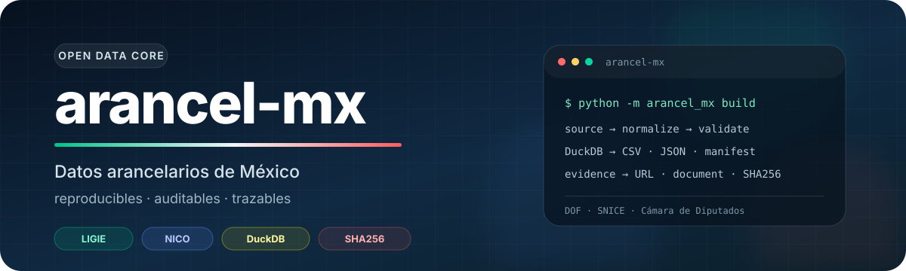
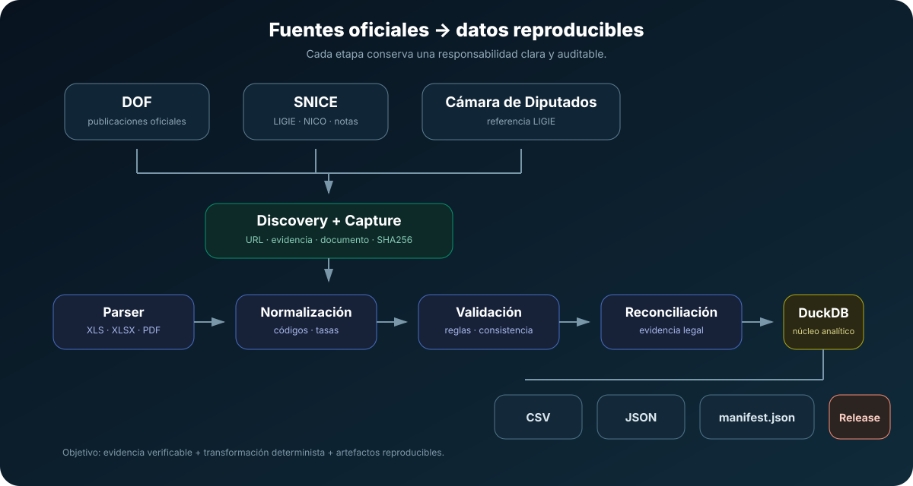

<div align="center">



# arancel-mx

## Verifiable Mexican tariff data, ready to use

`arancel-mx` turns official LIGIE/NICO publications into an open, reproducible data layer that can be consumed through files, DuckDB, CLI, Python, or HTTP.

<p>
  <a href="./README.md">Español</a> · <strong>English</strong>
</p>

[](https://github.com/jccontrerasg08-cpu/arancel-mx/actions)
[](https://www.python.org)
[](LICENSE)
[](https://duckdb.org/)

**[Open hub](https://arancel-mx.vercel.app/)** · **[API documentation](https://arancel-mx.vercel.app/documentation)** · **[Latest data](https://github.com/jccontrerasg08-cpu/arancel-mx/releases/latest)** · **[Documentation](docs/README.md)**

</div>

**Why it exists.** Mexican tariff data is published across sources, pages, and documents with different roles. Reliable consumption requires provenance, validity, hierarchy, evidence, hashes, and a reproducible dataset identity. `arancel-mx` centralizes that work so downstream applications do not need to rebuild their own version of LIGIE/NICO.

The interactive experience lives at **[arancel-mx.vercel.app](https://arancel-mx.vercel.app/)**. GitHub holds the code, verifiable releases, and deep documentation.

## What you can do

| I want to... | Surface | Start here |
|---|---|---|
| Search a tariff fraction, HS code, or NICO in a browser | **Web hub** | [arancel-mx.vercel.app](https://arancel-mx.vercel.app/) |
| Analyze many rows with SQL, BI, notebooks, or ETL | **Data / DuckDB** | `arancel-mx data download` |
| Query codes and tariff cards quickly | **CLI** | `arancel-mx lookup 01012101` |
| Integrate data into an application | **Python** | `from arancel_mx import Dataset` |
| Consume a GET-only/read-only interface | **HTTP / API** | `GET /data/v1/meta.json`, `/data/v1/records/85.json` |
| Verify how a result was produced | **Audit and reproduction** | `manifest.json`, `SHA256SUMS`, `provenance`, `data verify` |

The **public HTTP API** is **GET-only**, **read-only**, and requires **no API key**: static JSON files that GitHub Pages publishes with each release and the hub serves under `/data/v1`. The route-and-limit hub lives at `/documentation`.

The Python package and the dataset have separate version cycles. A package version does not pin the data: dataset releases use immutable `data-YYYY.MM.DD` tags.

**Direct downloads:** [DuckDB](https://github.com/jccontrerasg08-cpu/arancel-mx/releases/latest/download/arancel_mx.duckdb) · [CSV](https://github.com/jccontrerasg08-cpu/arancel-mx/releases/latest/download/arancel_mx.csv) · [JSON](https://github.com/jccontrerasg08-cpu/arancel-mx/releases/latest/download/arancel_mx.json) · [Manifest](https://github.com/jccontrerasg08-cpu/arancel-mx/releases/latest/download/manifest.json) · [SHA256SUMS](https://github.com/jccontrerasg08-cpu/arancel-mx/releases/latest/download/SHA256SUMS)

## Start in 60 seconds

```bash
pip install arancel-mx
arancel-mx doctor
arancel-mx data download
arancel-mx lookup 01012101
arancel-mx data verify
```

Or read the static API from the same domain (chapter 85 contains `8517130100`):

```bash
curl "https://arancel-mx.vercel.app/data/v1/meta.json"
curl "https://arancel-mx.vercel.app/data/v1/records/85.json"
```

For formats, cache behavior, offline mode, and explicit dataset selection, continue with the [consumer quickstart](docs/consumer-quickstart.md) and [CLI reference](docs/consumer-cli.md).

## Why trust it

Trust does not depend on a README claiming the data is current. Every valid publication preserves a verifiable chain from observed sources to published bytes:

```text
official sources
      ↓
capture + identity + SHA256
      ↓
reconciliation + validation
      ↓
canonical DuckDB + CSV + JSON
      ↓
manifest + checksums + captured sources
      ↓
immutable GitHub Release
```

<p align="center">
  
</p>

GitHub Actions builds and publishes; GitHub stores the release and serves its static API; Vercel only serves the site. The **verified release remains the source of truth** ([architecture](docs/architecture.md)).

Go deeper with [official source roles](docs/official-source-roles.md), [sources and reconciliation](docs/sources.md), the [data model](docs/data-model.md), and the [release process](docs/release-process.md).

## Documentation

| Need | Document |
|---|---|
| Install, download, and query | [Consumer quickstart](docs/consumer-quickstart.md) · [CLI](docs/consumer-cli.md) |
| Integrate files, Python, or HTTP | [External consumption](docs/external-consumption.md) |
| Understand HS → MX tariff fraction → NICO | [NICO/LIGIE guide](docs/nico-ligie-guide.md) |
| Understand provenance and source promotion | [Official roles](docs/official-source-roles.md) · [Sources](docs/sources.md) · [SNICE_DOCS promotion](docs/source-promotion.md) |
| Understand the project and its boundaries | [Project overview](docs/project-overview.md) · [Architecture](docs/architecture.md) |
| Browse all documentation | **[Documentation center](docs/README.md)** |

## Scope

`arancel-mx` is a public technical data layer for LIGIE/NICO, provenance, and reproducible consumption. It is not a full foreign-trade platform and **does not classify goods or provide legal advice**.

The code is distributed under [Apache-2.0](LICENSE). To contribute, see [CONTRIBUTING.md](CONTRIBUTING.md), [SECURITY.md](SECURITY.md), [CODE_OF_CONDUCT.md](CODE_OF_CONDUCT.md), and [TERMS.md](TERMS.md).

**[Hub](https://arancel-mx.vercel.app/)** · **[API documentation](https://arancel-mx.vercel.app/documentation)** · **[Releases](https://github.com/jccontrerasg08-cpu/arancel-mx/releases/latest)** · **[Docs](docs/README.md)** · **[Español](README.md)**
